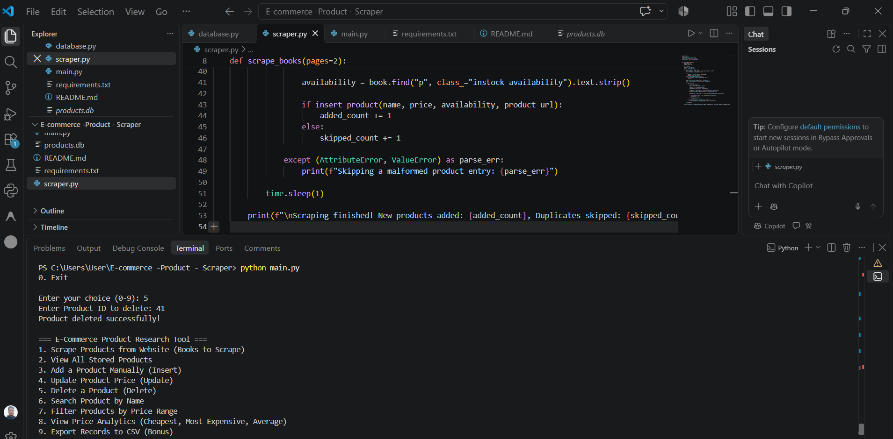
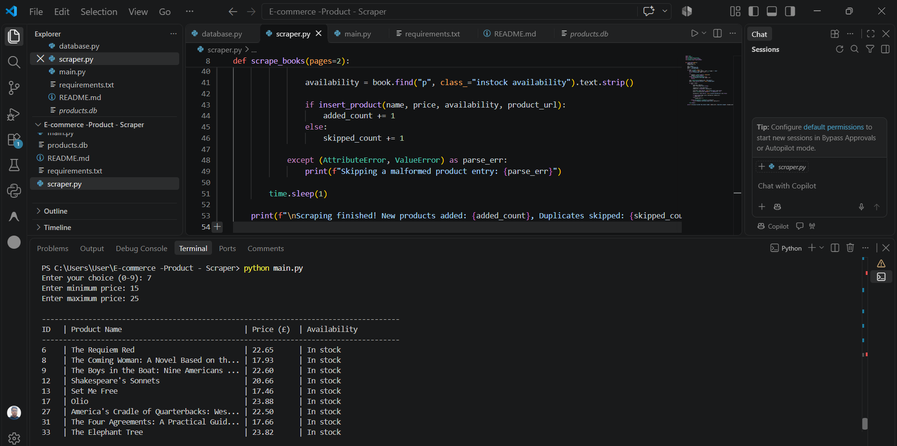
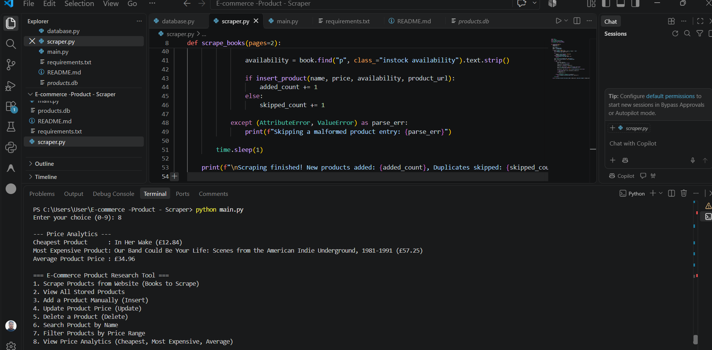

# E-Commerce Product Scraper & Market Research Tool

A Python CLI application for scraping online product data (`requests`, `BeautifulSoup`) into an SQLite database (`sqlite3`) for market analysis.

## Core Features
- **Data Collection:** Scrapes book titles, prices, availability, and links from [Books to Scrape](https://toscrape.com).
- **Database & CRUD:** Duplicate prevention via `UNIQUE` constraints, full CRUD operations, keyword/price filtering, and SQL price analytics (`ORDER BY`, `AVG`).
- **Export:** Supports exporting data to `products_export.csv`.

## Project Structure & Setup
```text
E-Commerce-Product-Scraper/
├── database.py / scraper.py / main.py
├── products.db / products_export.csv / requirements.txt
└── Screenshots/ & README.md
```
1. Clone repo: `git clone https://github.com/Saiful-Islam-Cyber/E-Commerce-Product-Scraper.git`
2. Install deps: `pip install -r requirements.txt`
3. Run app: `python main.py`

## Sample Output Screenshots
### 1. Web Scraping & Data Collection


### 2. Stored Products & Price Filter


### 3. SQL Price Analytics

